# Restricted real-data PoC: P0 remediation

Reviewed on 2026-11-19. This is a source-and-mock verification report, not production approval or a claim of legal compliance or complete security.

## Baseline and scope

The supplied `SECURITY_POC_REVIEW.md` was read from the existing local checkout. Its November 17 snapshot was based on `1879757694dced5530aca80db499323dc4300767` plus local changes. Those changes and that historical report were left untouched. They are **not** the baseline for this patch.

The isolated branch `codex/poc-p0-review-boundaries` starts at current upstream main `f942db4ecb6e696d75022d3f01a52b8bf2a37cf0`. A second fetch before PR preparation confirmed that main had not moved. Implementation commit: `44c796de26f0992311c78fbd06523997b87b4cae`.

Main already had signed actor/purpose/body-bound review receipts, changed/deleted prior-session checks, authenticated storage access, and some fixed diagnostic messages. The old audit failures were not simply copied forward. The remaining paths below were reproduced against main or against the still-unmodified boundary during this patch.

Only code, configuration templates, migrations relevant to existing architecture, tests, and synthetic in-memory records were used. No `.env`, private keys, real counseling files, production database, production logs, live model calls, migrations, remote data cleanup, or deployment were used. Existing installed dependencies were reused. A PR is for review; it does not authorize deployment or merging.

## Changes and evidence

| Issue | Revalidated before fixing | Minimal change and evidence | Status |
| --- | --- | --- | --- |
| P0-1: review could be disabled; raw detector input preceded approval | `REQUIRE_DEID_REVIEW=0` admitted direct generation/recomposition; detector preview accepted source before any approval | `Settings.poc_mode=True` and `review_required()` make the PoC boundary mandatory. A local preparation endpoint projects exact current input and owned prior context without calling AI. A signed preparation token is required before detector submission; final reviewed receipt is still required before generation. See `backend/app/core/config.py:36`, `backend/app/services/deid_review.py:164`, `:183`, `:193`, `:278`, `backend/app/api/routes/notes.py:92`, and `frontend/src/components/deidentification/AIReviewHost.tsx:67`. | Confirmed by code and mock regression; deployment unverified |
| P0-1a: guest approval was scoped to an IP-derived identity | Legacy guests could request detection and summary; shared-browser handoff could save a prior guest result under the next signed-in user | PoC review requires a verified `AuthenticatedActor`; final generation checks retain that actor object. Guest creation routes to login. Guest local-storage writer/consumer and automatic save after login are removed; legacy pending content is discarded without reading/displaying it. `deid_review.py:168`, `notes.py` `review_actor`, `frontend/src/lib/quickSummary.ts:126`, `QuickSummaryWorkspace.tsx:123`, `LandingPage.tsx:16`. | Confirmed by code and mock regression |
| P0-1b: a prompt-bearing option was hidden from review | An arbitrary API-supplied `visible_section_ids` string entered the recompose prompt but was excluded from review sources | Include these accepted values in both review screens with the label `출력 항목`; do not change supported document sections or the model stack. `deid_review.py` `INTERNAL` / `LABELS`; `backend/app/graph/nodes.py:1256` is the unchanged prompt sink. | Confirmed by focused red → green test |
| P0-2: exception and validation output exposed counseling content | Case errors printed traceback and interpolated exception text. Export failure history included error strings. Parser/provider causes and Pydantic request, response, and stored-draft validation could expose values | Fixed public messages and static diagnostic codes, exact allowlist for known safe messages, `from None`, and shared private validation handlers. `backend/app/api/error_privacy.py:89`, `:94`, `:99`; routes `cases.py`, `notes.py`, `audio.py`, `materials.py`, `documents.py`; main/audio applications and API wrappers. Preserve status codes and file-cleanup `finally` paths. | Confirmed for tested application paths; infrastructure tracing unverified |
| P0-3: original input and plaintext recompose cache could remain enabled | Original input defaulted on. Explicit storage/cache flags overrode the intended PoC restriction | Original storage defaults off. In PoC, `_session_raw_input()` always omits `raw_input_text`; both cache entry points and low-level read/write helpers return without file access. Policy endpoint and Settings show effective behavior. `supabase_storage.py:696`, `recompose_cache.py:29`, `:139`, `:151`, `storage_policy.py`, both `.env.example` templates. | Confirmed by storage mocks and synthetic temporary files |

The final receipt still binds actor, purpose, the entire normalized payload hash (including case ID and session number/IDs where present), and expiry. Changing input, owner, case, session, purpose, or historical-source revision invalidates it. The same approved version can be retried within its one-hour lifetime. This is not a durable revocation ledger: editing the browser does not revoke an older receipt for the older, already-approved payload. A new/changed payload requires new approval. Tokens contain hashes and scope metadata, not counseling body text.

## Resulting flow and compatibility

```mermaid
flowchart LR
    A[Authenticated browser input] --> B[Local preparation: exact sources and owned history]
    B --> C[Counselor approves raw detector input]
    C --> D[Server verifies preparation token and current history]
    D --> E[Configured entity detector]
    E --> F[Counselor reviews and applies replacements]
    F --> G[Server signs exact reviewed version]
    G --> H[Generation or regeneration verifies receipt]
    H --> I[Existing model pipeline]
    I --> J[Owned saved note and sanitized evidence]
    J --> K[Reopen, confirm, evidence view and export]
```

Both generation and recomposition reject missing/changed receipts before their model functions. The same verification wraps quality retries. Prior-session retrieval is owner-scoped and included before the first approval; history is checked again before detection and generation. Cancellation/failure resets review context; polling retains the original payload, actor, and preparation token.

This patch changes no model, encryption algorithm, key management design, database schema, or RLS policy. PoC now requires configured real-user authentication and the existing review-signing key. A non-PoC deployment can explicitly opt into legacy settings with `POC_MODE=0`; this mode is outside the real-data PoC acceptance contract. Legacy subsystem tests set it explicitly; the dedicated protected PoC runner clears inherited configuration and tests the safe defaults.

Owned note saving, confirmation, reopening, evidence references, DOCX export, and signed-in quick-summary save/retry remain covered. New PoC records reopen sanitized input instead of an additional original-input copy. Original-input deletion still preserves final notes; it is not whole-record erasure. Previously saved originals are not retroactively removed. Drafts, profiles, sanitized text, reviewed summaries and excerpts remain sensitive stored data. Disabling `raw_input_text` is not a promise that no counseling text is retained.

## Red → green evidence

No test below contacted a real provider or used an external test account. Backend commands use the protected runner, which clears inherited service credentials, blocks dotenv/credential-file reads, patches the settings dotenv loader, blocks network/DNS/subprocess calls, and isolates temporary storage. Its Windows socketpair exception is restricted to the standard library's internal loopback wakeup. No skipped tests count as a pass.

| Contract | Red observation | Green observation |
| --- | --- | --- |
| `test_poc_approval` | Initial 8 methods failed at main; 10 assertion failures including direct API cases. A follow-up visibility test failed before its targeted fix. Positive approved-request control passed. | 10/10 methods |
| `test_poc_diagnostics` | Original 5 methods: 1 passed, 4 failed (34 subtest failures). Added request-validation, response-validation and stored-draft checks failed in 5, 2 and 7 host/operation combinations before their handlers were added. | 8/8 methods |
| `test_poc_storage` | 2 passed, 5 failed, including raw-column omission and low-level cache access | 7/7 methods |
| Guest isolation and effective storage UI | Initial 5 tests: 2 passed, 3 failed; added effective-policy and guest-login controls failed before their fixes | 7/7 tests |
| Detector approval UI | Initial 4 tests failed before preparation was implemented; transport/polling contract added afterward | 5/5 tests |

Validation ledger (UTC; deployment ID/URL: **none**, environment: local Windows, synthetic mocks):

| Code version | Time / check | Result | Cleanup |
| --- | --- | --- | --- |
| `f942db4` + test-only additions / subsequent untouched boundaries | 2026-11-19, before each targeted edit; red checks described above | Reproduced expected failures; initial direct-route test harness was corrected to capture HTTP 500 instead of raising server exceptions, then rerun red | In-memory mocks / temporary directories only |
| `44c796d` implementation content | Results recorded at 2026-11-19 05:56 UTC; `python backend/tests/run_poc_review.py` | **25 passed**, zero skips | Runner temporary directory removed; no external data created |
| Same implementation | Results recorded at 2026-11-19 05:56 UTC; `cd frontend; node --test scripts/verify-poc-detection-approval.test.mjs scripts/verify-poc-guest-isolation.test.mjs` | **12 passed** | In-memory hooks, storage and API mocks |
| Same affected runtime, before final validation-handler additions | 2026-11-19, completed by 05:37 UTC; protected runner `--legacy` with `test_iwinv_review test_reviewed_history test_security_access_boundaries test_security_storage_policy test_security_route_diagnostics test_security_retrieval_logs` | 59 passed initially; route-inventory test identified missing declared dependency on new prepare route. Fixed to use `PreviewActor`, then passed in next batch. One mistakenly requested nonexistent `test_recompose_cache` module was a test-selection error, not an application failure. | Synthetic only |
| Same affected runtime | 2026-11-19 05:37 UTC checkpoint; protected runner `--legacy` with the failed route-inventory method, `test_security_temporary_files test_security_memory_source_validity test_case_list test_openai_audio test_clova_audio test_local_audio_pipeline test_security_upload_cancellation test_security_upload_lifecycle` | **96 passed**; covers owned boundaries, success/failure/cancellation cleanup, legacy caching and deleted-source behavior | Synthetic scratch files cleaned |
| Same frontend implementation | 2026-11-19 05:38 UTC; `node scripts/verify-auth-flow.mjs`, `node scripts/verify-persistence-workflow.mjs`; browser-script syntax; `git diff --check` | Passed, including signed-in save retries | No accounts or remote rows |
| Same frontend implementation | 2026-11-19 05:38 UTC; `tsc --noEmit` | **Not complete:** local preinstalled dependencies lack `pdfjs-dist` used by existing `VoucherPdfPreview.tsx` (TS2307). No package installation performed. | Read-only compiler check |

The revised `verify-quick-summary-login-browser.mjs` was syntax-checked only. No browser E2E, production smoke test, real model quality evaluation, deployed RLS exercise, or PDF runtime export check is claimed. A CI run with locked dependencies must complete the frontend type/build check. Do not deploy this branch merely because mocked checks pass.

At 2026-11-19 05:56 UTC the optional Codex Security diff-scan integration rejected the isolated worktree with `Review changes requires a non-bare Git worktree with a resolvable HEAD.` Git itself resolved the committed HEAD successfully. No scan started and no scanner pass is claimed. Per repository instructions, focused source review continued: independent reviewers checked the new gate, frontend transition, diagnostic boundaries and cleanup. Their prompt-option visibility and stored/response-validation findings were fixed and tested before the implementation commit. This does not replace a security expert's review.

## Remaining PoC prerequisites and reviewer questions

1. Verify the actual deployed API origins, TLS, reverse-proxy routing and version alignment for frontend, note API, audio API and detector worker. Code naming a self-hosted service does not prove deployment ownership, region or processing locality. Confirm the new prepare route is reachable and old clients fail safely.
2. Verify `POC_MODE=1`, real-user authentication, reviewed-input signing configuration, provider credentials and deployment access controls without including their values in this report. Confirm `POC_MODE=0` is prohibited for the real-data PoC. Determine whether a one-hour retryable receipt is acceptable or whether revocation/audit requirements need a later design.
3. Verify deployed RLS and grants with separate synthetic accounts in a separately authorized environment: A cannot read/edit/export/delete B's known record IDs, drafts, transcripts or evidence. Mocks and source filters do not prove deployed database policy.
4. Identify every retained copy: existing raw-input rows, historical plaintext cache files, drafts, transcripts/checkpoints, detector jobs, exports/downloads, browser persistence, logs, snapshots and backups. This patch prevents new recompose cache access/writes; it does not delete existing files or backups. Approve retention windows, deletion ownership, restore behavior and any separate cleanup plan before real data.
5. Verify error reporting, APM/tracing, proxy request logging and crash dumps do not capture bodies, exception locals or credentials. Synthetic application-log tests do not attest to infrastructure collectors. Review metadata/URL logging separately.
6. Confirm who can access encryption keys, decrypt sensitive fields, administer Supabase/storage and recover backups. This pass intentionally does not redesign key management or establish operator-only access restrictions.
7. Validate actual detector and audio service retention, operator access and subprocess behavior; OpenAI/CLOVA or other configured providers' contractual retention, training use, region, subprocessors and deletion terms. Audio transcription continues under its existing explicit upload consent path; text review tokens govern detector/generation input, not audio bytes.
8. Review manual approval UX and pseudonymization quality using synthetic edge cases, including missed identifiers, prior sessions, supplementary fields, regeneration and account changes. Approval is a scoped user action, not proof that the counselor read every word or that all identifiers were removed.

## Consent-language boundary

After verified deployment with PoC settings, the code supports statements that text detection and subsequent summary generation require separate approval of a specific input version; edited inputs require renewed approval; new PoC session rows omit the optional original-input column; recompose disk caching is disabled; and guest results are not automatically transferred to a later account.

It cannot currently support unconditional claims that all processing stays on an owned server, that only anonymous data reaches providers, that no original or identifiable information is ever retained anywhere, that operators cannot decrypt data, that deletion instantly removes all copies/backups/vendor data, or that the service is fully secure or legally compliant. Provider-policy, deployment, organizational and legal reviews remain separate requirements.
